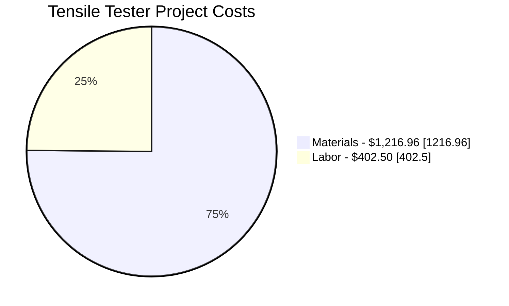

# Assignment 11: Motor Selection Design

## Introduction - Roncellis Marshall

The goal of Assignment 11 was to continue developing the tensile tester designed during Assignment 10. For this stage, our team focused on selecting the motor and designing the additional components needed to complete the mechanical drive system and supporting frame. Our team consists of Joshua Malonda, Roncellis Marshall, and Brodie Jarvis.

We used several results from Assignment 10 as the starting point for this phase, including the lead screw dimensions, required rotational speed, and estimated torque. These values helped guide our motor selection and the design of the motor mounts, couplers, frame connections, and floating bearing support.

Throughout the project, we documented our design decisions, engineering calculations, component research, challenges, and changes made during the modeling process. The main objective was to develop a mechanically driven tensile tester capable of supporting the required 2 kN tensile load while maintaining the specified operating speed and safety requirements.

The following sections document our design process, calculations, component selections, and CAD development based on the tensile tester concept and requirements provided in the assignment.

## Motor Selection and Attachments (Joshua Malonda)

### Motor Selection

Before selecting a motor, I went back through the calculations from Assignment 10 to review the torque and rotational speed requirements for our lead screw system. Since the motor would be responsible for driving both lead screws and moving the crosshead under the required tensile load, it was important to make sure the values from the previous assignment were understood before choosing a motor.

I also revisited the torque calculation to check that the earlier result was consistent with the design requirements. After reviewing the calculations, I used the required crosshead speed range and the lead of our selected 1/2"-10 Acme lead screws to establish the motor speed requirements. The selected lead is 0.100 inch per revolution, which is equivalent to 2.54 mm per revolution.

With these values established, I began researching motors that could provide the torque and rotational speed needed for the tensile tester. I used McMaster-Carr to compare available motor options and review their specifications, including rated speed, torque, voltage, and mounting configuration. The motor selection needed to work with the existing lead screw design while providing enough output torque to move the crosshead under the required loading conditions.

The next step was to compare the selected motor's specifications with the calculated requirements and determine whether it could operate safely within the design limits.

### Motor Mount Design (Joshua Malonda)

The motor mounting bracket was one of the parts that required me to spend more time understanding the design before moving forward with the calculations. I had to look closely at the motor's dimensions and determine how those measurements would affect the bracket and its attachment points. Once I understood the geometry, I identified the information needed to calculate the minimum bracket thickness.

For the material, I went with 6061-T6 aluminum. I had already researched aluminum alloys during Assignment 10, so I was more familiar with their mechanical properties and considered aluminum a suitable starting point for this component. I used a yield strength of 250 MPa in the analysis.

I also had to work through the free-body diagram carefully. My initial approach did not communicate the loading situation as clearly as I wanted, so I spent additional time organizing the forces and dimensions. Revising the diagram helped me better understand how the motor's loading would transfer through the bracket and gave me a clearer starting point for the bearing-stress calculation.

This part of the assignment showed me that understanding the geometry and correctly representing the forces are just as important as selecting the right equation. A calculation is only useful if the diagram and assumptions accurately represent the component being designed.

### Motor Mount Thickness Selection (Joshua Malonda)

After completing the bearing-stress calculation, I obtained a minimum required thickness of 0.83 mm. Although this value satisfied the theoretical calculation, I did not think it was a practical choice for the actual motor mount. A bracket this thin could be more sensitive to bending, handling, and other loads that may occur during assembly and operation.

I initially increased the proposed thickness to 0.250 inches (6.35 mm) to provide a more substantial mounting surface. However, after discussing the design with the teammate responsible for building the motor mount, we agreed on a final thickness of 0.150 inches (3.81 mm). This allowed us to move forward with a practical design while keeping the bracket thicker than the calculated minimum.

This decision helped me understand the difference between a theoretical minimum obtained from an equation and a dimension selected for an actual mechanical component. The final thickness should still be checked against the expected loading and deflection of the completed bracket.
### Coupler Design and Selection (Joshua Malonda)

The coupler was another component that needed to be evaluated before the motor could be connected to the lead screw system. Since the coupler transfers rotational motion and torque from the motor shaft to the lead screw, its dimensions needed to be checked to make sure it could handle the expected loading.

I approached this part by separating the known information from the dimensions that still needed to be determined. I then created a free-body diagram to represent the applied torque and identify the inner and outer diameters of the coupler. I used the proposed outer diameter as the starting point for the torsional stress analysis and worked through the equations to determine the required inner diameter. From there, I calculated the material thickness between the two diameters.

The analysis resulted in a calculated coupler wall thickness of 8.73 mm. This gave me a starting point for evaluating the coupler dimensions and comparing the calculated geometry with the available component options. This section helped me better understand how torque is transmitted through a coupling and why the material surrounding the shaft openings must be strong enough to resist torsional shear stress.

### Coupler Selection (Joshua Malonda)

After completing the torsional analysis, I moved on to identifying a coupler that could work with the motor and lead screw dimensions established for our design. I wanted to select a component that would fit the existing setup and allow my teammate to move forward with the SolidWorks assembly without having to create a completely custom coupling.

The component selected was a **Clamping Precision Flexible Shaft Coupling** made from aluminum. It has a 1/2-inch bore on one end and a 5/16-inch bore on the other, with an overall length of 2-3/8 inches and an outside diameter of 1-1/2 inches. The different bore sizes allowed the coupling to connect the motor shaft to the lead screw.

I shared the selected component and its dimensions with my teammate so they could incorporate it into the CAD assembly. This selection connected the results of my torsional analysis with an available manufactured part and helped move the overall design toward completion.

**Selected Component:**
- Component: Clamping Precision Flexible Shaft Coupling
- Material: Aluminum
- Type: Spiral
- Motor-side bore: 5/16 inch
- Lead-screw-side bore: 1/2 inch
- Overall length: 2-3/8 inches
- Outside diameter: 1-1/2 inches

### Frame Connector Selection (Joshua Malonda)

Selecting the connectors for the T-slot frame was an important part of making sure the individual frame sections could be assembled securely. I started by identifying the known dimensions and loading conditions, along with the values that still needed to be determined. Before substituting numerical values, I organized the equations and solved for the unknowns symbolically. This made it easier to follow the analysis and check the results.

When researching possible connectors, I initially considered an option listed through Grainger. However, that particular component did not have an available CAD model, which would have made it difficult to include accurately in our SolidWorks assembly. I continued comparing alternatives and found a similar T-slot framing structural bracket through McMaster-Carr.

I selected the McMaster-Carr bracket because its design and dimensions were better suited to our frame requirements, and its CAD model could be used in the assembly. This allowed us to account for the connector during the modeling process instead of estimating its geometry. The calculations and selected connector are shown below.

### Floating Bearing Mount Design (Joshua Malonda)

For this part of the project, I focused on developing the floating bearing mount and determining dimensions that would allow it to fit properly within the frame. Rather than choosing dimensions without a clear basis, I considered how each measurement would affect the bearing's placement, the mounting arrangement, and the overall fit of the assembly.

One requirement was to determine the appropriate clearance-hole size. I used the Machinery's Handbook as a reference to identify the recommended clearance for the selected fastener. I then incorporated that information into the mounting dimensions so the holes would provide the necessary clearance during assembly.

I also documented the tolerances needed for the mount. These tolerances are important because the bearing and its supporting features must fit together correctly without creating unnecessary interference or alignment problems. The final dimensions, clearance-hole selection, and tolerance requirements are provided below, along with the reasoning behind the design choices.

## Bill of Materials and Labor Costs (Brodie Jarvis)

To estimate the overall cost of the tensile tester, we compiled a bill of materials containing the components and materials needed for the design. The prices were collected from the suppliers' product pages using the links associated with each selected item. We also included labor costs to account for the time spent completing the engineering and design work.

The combined material and labor cost for the project was **$1,619.46**. The complete cost breakdown, including the individual components and labor, is available below.

## Project Cost Breakdown

The following table summarizes the material and labor expenses for our tensile tester design. Component costs were collected from the supplier listings used during the design process. Labor was estimated at $35 per hour.

| Cost Category | Amount |
|---|---:|
| Materials and Components | $1,216.96 |
| Engineering Labor | $402.50 |
| **Total Project Cost** | **$1,619.46** |

### Materials vs. Labor

### Cost Estimation

Material costs were based on the supplier prices recorded for the selected components. Labor costs were calculated using the estimated hours worked and an engineering labor rate of $35 per hour.

The combined estimated cost for Assignments 10 and 11 was **$1,619.46**.
## CAD Files (Brodie Jarvis)
Figure 1. Motor mount plate modeled in SOLIDWORKS, showing the mounting holes and larger openings for component attachment.

Figure 2. T-slot aluminum extrusion modeled for the tensile tester frame, including the slots used for mounting and alignment.

Figure 3. Complete tensile tester frame assembly showing the vertical supports, top crossmember, base, and moving plate.

Figure 4. Top frame extrusion with applied restraints and loading locations prepared for finite element analysis (FEA).

Figure 5. Top frame FEA von Mises stress plot showing a maximum stress of approximately 9,108 psi under the applied loading.

Figure 6. Top frame FEA displacement plot showing a maximum resultant displacement of approximately 0.00155 in near the center span.

Figure 7. Alternate view of the top frame stress distribution, highlighting stress concentrations near the supported end and load application points.

Figure 8. Alternate view of the top frame displacement distribution, showing the greatest deflection along the middle of the extrusion.

Figure 9. Top frame factor-of-safety plot showing a minimum safety factor of approximately 9.13 for the analyzed loading condition.

Figure 10. Side frame extrusion stress analysis showing low von Mises stresses, with a maximum of approximately 442 psi.

Figure 11. Side frame displacement analysis shown in an inverted view, with a maximum displacement of approximately 0.00271 in.

Figure 12. Side frame factor-of-safety plot showing a minimum safety factor of approximately 203.5.

Figure 13. Additional side frame stress result showing the bending response and distribution of stress along the vertical member.

Figure 14. Additional side frame stress result from the same view, included for comparison of the stress contours.

Figure 15. Side frame displacement plot showing maximum deflection at the free end of the vertical extrusion.

Figure 16. Side frame factor-of-safety result showing a minimum value of approximately 170.2.

Figure 17. Side frame stress plot for a refined mesh, showing a maximum von Mises stress of approximately 466.4 psi.

Figure 18. Refined-mesh side frame displacement plot showing a maximum displacement of approximately 0.002701 in.

Figure 19. Refined-mesh side frame factor-of-safety plot showing a minimum value of approximately 192.9.

Figure 20. Mesh comparison table for the side-frame FEA, comparing maximum stress, displacement, and minimum factor of safety across medium, fine, and medium-fine meshes.

## What Could Have Been Improved (Brodie Jarvis)

Although we were able to develop the major components of the tensile tester, there were several areas of the design process that could have been handled better. One improvement would have been to spend more time verifying component specifications before finalizing our selections. For example, selecting a motor based on its listed speed and torque is not enough by itself. We also needed to consider how its available torque changes with operating speed and whether the motor could meet the full crosshead speed requirement. A more detailed comparison of motor options could have helped us make a stronger selection.

Another area that could have been improved was the connection between our theoretical calculations and the actual manufactured components. The coupler analysis provided a calculated thickness, but the dimensions of an available commercial coupling do not necessarily match a simplified theoretical model. In the future, we would compare the calculated dimensions with the manufacturer's specifications, material properties, and torque rating before deciding that a component meets the design requirements.

We also could have improved the way we approached the motor mount and frame connections. During the design process, some dimensions and mounting details required additional discussion and adjustments before they could be incorporated into the SolidWorks assembly. Establishing the motor mounting pattern, fastener locations, and required clearances earlier would have reduced some of the back-and-forth between the calculations and CAD modeling.

The FEA process could also have been more efficient. Mesh changes and convergence checks required additional time, particularly when trying to obtain consistent results for the frame components. A better approach would have been to establish a clear mesh refinement plan before running the simulations and to document the results from each iteration in a consistent format. This would make it easier to determine whether the results were reliable and identify areas that needed reinforcement.

If we were to repeat this assignment, we would spend more time checking calculations against manufacturer data, coordinating component dimensions before completing the assembly, and planning the FEA process earlier. We would also leave more time for a final review of the entire design to identify fit, alignment, strength, and documentation issues before submission.

Overall, the project showed us that completing an individual calculation or selecting a component is only one part of engineering design. Each decision needs to be checked against the actual assembly and the requirements of the complete system.
## Lessons Learned (Joshua Malonda)
Working on Assignment 11 gave me more experience with how individual mechanical components come together in a complete assembly. One area I learned more about was using SolidWorks features to develop and position parts so they could fit correctly within the overall design. I also gained a better understanding of how T-slot connectors and their fasteners affect the strength and stability of a frame.

Another important part of the assignment was accounting for fit and material selection. Designing the floating bearing mount required more attention to clearances and tolerances because small dimensional differences can affect how components fit and operate together. The motor mount, coupler, and frame connections also showed me why each component needs to be evaluated against its expected loading rather than selected based only on whether it fits the assembly.

Overall, this assignment helped me connect component selection, engineering calculations, and CAD modeling. It reinforced the importance of checking dimensions, material properties, and safety factors before considering a design complete.

Our team spent approximately **13 hours** completing Assignment 11.
Files for Parts:
https://drive.google.com/drive/folders/1PqWF8aAedd_mpIGteUJ0H32ValFs9vjE?usp=sharing
